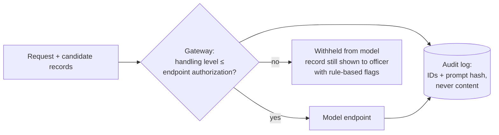

# foia-assist

A working prototype of a generative-AI assistant for a government FOIA office, built the way an agency deployment has to be built. Content never reaches a model endpoint that isn't authorized for it. Every decision is logged. People make every release decision. It runs the same on a laptop, in a government cloud, or air-gapped.

A FOIA request comes in and the assistant produces a **case packet** for a FOIA officer:

- **Triage**: processing track, fee category, date range, program, and whether the request needs clarification before anyone can search
- **Candidate records**: found with explainable search, each with its handling marking
- **Exemption pre-screen**: candidate b(4), b(5), b(6) and b(7) flags with the exact text and a reason, plus a redaction preview
- **Responsiveness notes**: written by a model, but only for records the chosen endpoint is authorized to see
- **A draft acknowledgment letter**

All records, people and the agency (the "Federal Grants Administration") are fictional.

## Quick start

Python 3.10+, standard library only.

```bash
python3 -m foia_assist serve                       # web app on http://127.0.0.1:8080
python3 -m foia_assist process "All records about rural broadband grant awards in 2025" --requester media
python3 -m evals.run_evals                          # release gates; exits 1 on failure
python3 -m unittest discover -s tests               # 22 tests
python3 -m backlog.score                            # regenerate docs/BACKLOG.md
```

Open `notebooks/01_walkthrough.ipynb` for a guided tour with saved outputs.

To use a model, set the key for an endpoint in `config/endpoints.json` (for example `OPENAI_API_KEY` for `commercial-cloud`) and pick that endpoint in the UI or pass `--endpoint`.

## The control that matters most



Each endpoint in `config/endpoints.json` declares the highest handling level it is authorized for: `PUBLIC`, `INTERNAL` or `CUI`. Before every model call, the gateway checks that level against the level of everything in the prompt. A record over the line is never sent; it still appears in the packet, with rule-based flags and a note explaining why the model didn't see it. Any code path that tries to send it anyway raises an error, and the attempt is audited.

The authorization levels in the config are **placeholders**. In a real deployment they come from the agency's ATO and each service's actual authorization.

## Evals

```
Release gates
  [PASS] recall_at_5                 100.0%   (target >= 90%)
  [PASS] track_accuracy              100.0%   (target >= 80%)
  [PASS] clarification_accuracy      100.0%   (target >= 100%)
  [PASS] high_severity_pii_recall    100.0%   (target >= 100%)
  [PASS] pii_recall                   87.5%   (target >= 85%)
  [PASS] leaked_records                   0   (target <= 0)
  [PASS] unblocked_violations             0   (target <= 0)
```

- The **leakage gate** runs every request through the full pipeline against a PUBLIC-only endpoint. It uses a fake client that records what it was sent, then checks that no restricted record reached the model, and that 11 direct attempts to send restricted records were all blocked.
- **The eval caught a real bug.** "Budget for fiscal year 2026" was being treated as a record date, which filtered out the FY2026 budget draft written in 2025. Recall was 90.9%. Fiscal years are now handled as a topic rather than a date filter, both in the rules and in the model prompt, and recall is 100%.
- **Known limits, kept visible:** the pattern-based PII screen misses names ("Laura Chen") and flags a federal employee's work phone. Fixing names needs an entity-recognition step inside the authorization boundary, logged as F3 in [`docs/FIELD_FEEDBACK.md`](docs/FIELD_FEEDBACK.md).

The eval set is 12 requests and 16 records, enough to exercise every path. A real pilot would use 100+ past requests labeled by FOIA staff (see [`docs/DEPLOYMENT.md`](docs/DEPLOYMENT.md#what-a-systems-integrator-needs-at-handoff)).

## How this maps to the role

| Applied AI Engineer, Government — posting | In this repo |
|---|---|
| Technical lead building novel applications on the OpenAI API | `foia_assist/`: structured outputs via JSON schema, a model-backed pipeline with an offline fallback |
| Identify high-value use cases; build a prioritized backlog | [`docs/BACKLOG.md`](docs/BACKLOG.md), generated from scored workshop ratings in `backlog/use_cases.json` |
| Hands-on prototypes that shorten time to value | Working web app, CLI and notebook, runnable offline in one command |
| Work alongside systems integrators and implementation partners | [`docs/ENGAGEMENT.md`](docs/ENGAGEMENT.md) and the SI handoff checklist in [`docs/DEPLOYMENT.md`](docs/DEPLOYMENT.md) |
| Network and cloud architecture, including on-prem | Three deployment patterns: government cloud, on-prem/enclave, air-gapped. Same code, config-driven |
| Publish notebooks and codify best practices | [`notebooks/01_walkthrough.ipynb`](notebooks/01_walkthrough.ipynb), executed with outputs |
| High-signal feedback to Product, Engineering, Research | [`docs/FIELD_FEEDBACK.md`](docs/FIELD_FEEDBACK.md): each item tied to a file, metric or test |

## Layout

```
foia_assist/      policy, corpus, search (BM25), prescreen, triage, llm, gateway, pipeline, server, static UI
config/           endpoints.json — the only place endpoint URLs and authorizations live
data/corpus/      16 synthetic agency records with handling markings
evals/            labeled requests, PII labels, run_evals.py with release gates
backlog/          use-case ratings and the scoring script
notebooks/        executed walkthrough
docs/             BACKLOG, DEPLOYMENT, ENGAGEMENT, FIELD_FEEDBACK
tests/            unit tests incl. gateway, clients (OpenAI-compatible + Azure), server
```

## Disclaimer

This is a portfolio prototype, not legal advice and not an authorized system. Exemption flags are candidates for human review, not determinations.

## License

MIT
