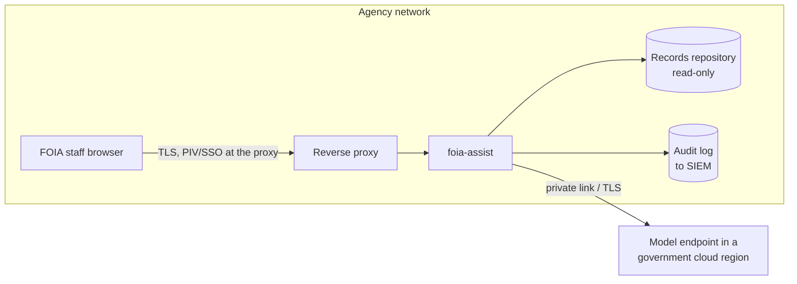
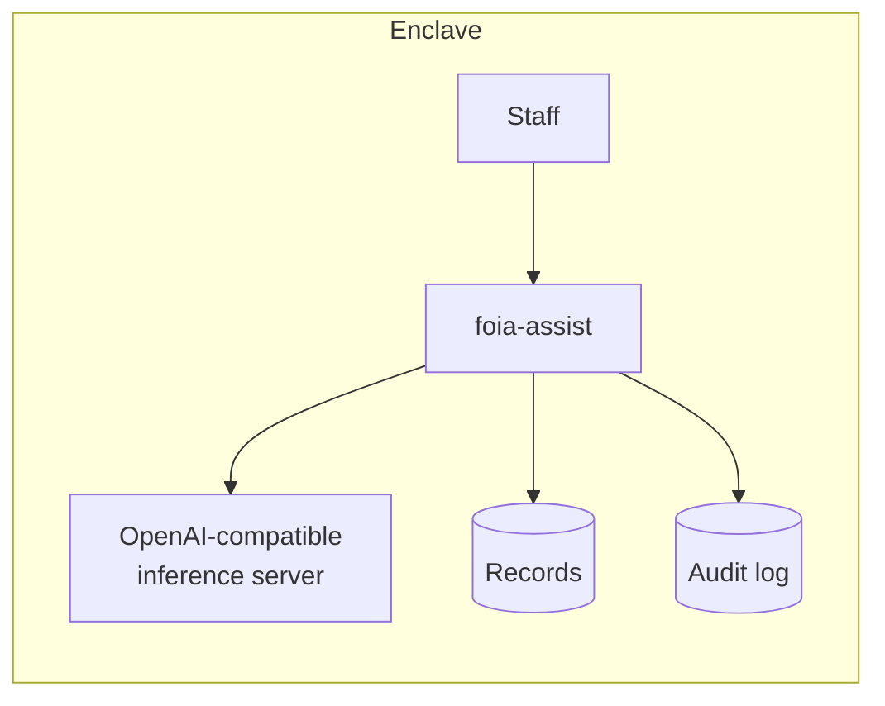

# Deployment patterns

The application code is the same in every pattern. What changes is which model endpoint is reachable and what it is authorized for, and that lives in one file: `config/endpoints.json`.

## 1. Government cloud

- Model calls go over a private connection to an endpoint inside the agency's authorization boundary.
- The endpoint's `authorized_level` is set from its actual authorization, for example its FedRAMP level or DoD impact level, as confirmed by the agency's authorizing official. This repo makes no claim about any specific service's authorization status.

## 2. On-premises or enclave

- Use the `on-prem` endpoint kind: any server exposing an OpenAI-compatible `/chat/completions` with JSON-schema output.
- No outbound internet. The app has no CDN assets, no package downloads at runtime and no telemetry.

## 3. Air-gapped / disconnected

- Run with the `offline` endpoint. Triage, search, exemption pre-screen and the acknowledgment draft all work with no model at all.
- That is the baseline the model-backed version has to beat in evals, and it keeps working if the model endpoint is down.

## Controls this prototype implements

| Concern | Control in this repo | Related NIST SP 800-53 family |
|---|---|---|
| Sensitive content reaching an unauthorized model | `gateway.py` checks every prompt's sources against the endpoint's authorized level; blocks and audits violations | AC (access control), SC (system & communications protection) |
| Traceability | JSONL audit of every request, model call, block and withheld record; IDs and prompt hashes, never content | AU (audit & accountability) |
| Prompt injection via request or record text | Content wrapped in tagged blocks with instructions to treat it as data; model output is advisory and schema-constrained; no tools with side effects | SI (system & information integrity) |
| Unsafe output rendering | UI renders only through `textContent`; strict Content-Security-Policy; no third-party scripts | SI |
| Automated decisions affecting the public | The model never decides release or exemptions; FOIA officer reviews every packet | (Agency AI governance policy) |
| Secrets | API keys from environment variables named in config; never logged | IA (identification & authentication) |

The control families are a pointer for the security team, not a compliance claim. The agency's ATO package decides what is required.

## What a systems integrator needs at handoff

1. **This repo** plus the eval suite in their CI (`python -m evals.run_evals` exits non-zero on a failed gate).
2. **Connector work:** replace `corpus.load()` with a read-only adapter to the agency's records system (e.g. its eDiscovery or records-management export). Keep the `Document` shape and the `marking` field.
3. **Identity:** put the app behind the agency's SSO/PIV proxy; pass the user identity into audit records.
4. **Endpoint config:** fill in `config/endpoints.json` from the ATO; remove endpoints that aren't authorized.
5. **Labeled data:** replace `evals/requests.json` with 100+ real (sanitized) past requests and their actual responsive records, labeled by FOIA staff.
6. **Runbook:** what to do when the model endpoint is down (switch the default to `offline`; nothing else changes).
